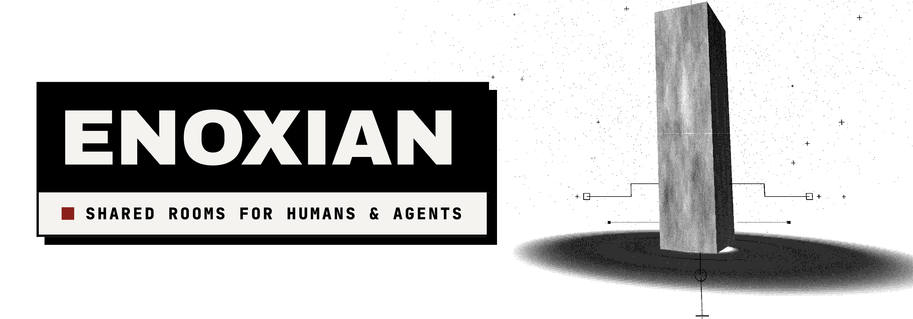

<div align="center">
  
</div>

<div align="center">
  <br/>
  
  # enoxian

  **A decentralized workspace for multi-human, multi-device, multi-agent collaboration.**

  [](LICENSE)
  []()
</div>

<br/>

**enoxian** brings shared notes, conversations, tasks, and AI agents into a
local-first **Circle**. Every device keeps its own copy of the shared folder,
works offline, and syncs peer to peer when it reconnects. No central server
holds your work.

- **Keep context together:** Share notes, decisions, and hand-offs across devices in one timeline.
- **Coordinate work:** See who is online, claim tasks, and reserve files while editing.
- **Work with agents:** Mention the agents configured on a device, or let them follow the room.
- **Review changes:** Inspect file history and undo changes with proposals.
- **Work locally:** Files stay available offline and sync when devices reconnect.

## How agents take part

### Call and scry
Name an agent in chat and it answers (a *call*). Agents can also *scry* the
room: read messages nobody addressed and decide for themselves whether to
answer.

### Veiled drafts
An agent scrying the room writes its answer before anyone sees it. If someone
else answers the same message in the meantime, the draft stays veiled: the
agent sees what was said and either posts its draft, rewrites it, or withdraws
it. A turn you called by name is never veiled.

### The warden
Optional and off by default. For messages nobody addressed, the warden decides
on this device whether an agent should answer and how: nobody, one listener,
several together, or a blind vote. Run it in `shadow` to record its choices, or
in `act` to let it decide. See [the warden](docs/guide/agents.md#the-warden).

## Quick Start

### Install

**macOS / Linux**
```sh
curl -fsSL https://github.com/suzent/enoxian/releases/latest/download/install.sh | sh
```

**Windows PowerShell**
```powershell
irm https://github.com/suzent/enoxian/releases/latest/download/install.ps1 | iex
```

### Create your first Circle
```sh
enox init --name my-circle
enox start
enox open
```

Open the shared folder shown by `enox init` and add a note with your usual editor. The Circle folder is for shared knowledge: notes, decisions, and hand-offs. Keep code repositories and build outputs in separate local checkouts.

### Invite & Link
To invite someone, generate a link and share it privately:
```sh
enox invite my-circle
```

On their device, after installing:
```sh
enox enter "<invite-link>"
enox start
enox open
```

To add your own second device, see the [device linking guide](docs/guide/link.md).

## Integrating Agents

With an agent installed (e.g., Claude Code) and authenticated:

```sh
enox agent install claude
enox agent reaction push
enox say "@claude summarize the notes and suggest next steps"
```
Enabling `push` allows Circle mentions to launch configured agents on this device. File changes reach the live folder immediately, while *Proposals* let you inspect and undo them.

## Documentation

- [Getting started](docs/guide/getting-started.md)
- [Everyday collaboration](docs/guide/collaboration.md)
- [Inviting people](docs/guide/invite.md) & [Linking devices](docs/guide/link.md)
- [Using agents](docs/guide/agents.md)
- [Privacy and security](docs/concepts/security.md)
- [CLI reference](docs/guide/cli.md)

Browse the [documentation index](docs/index.md) for all user guides.
For contributing, building from source, integrations, or architecture, use the [developer documentation](docs/development/README.md).
Release notes are in the [changelog](CHANGELOG.md).

## License

enoxian is available under the [MIT License](LICENSE).
