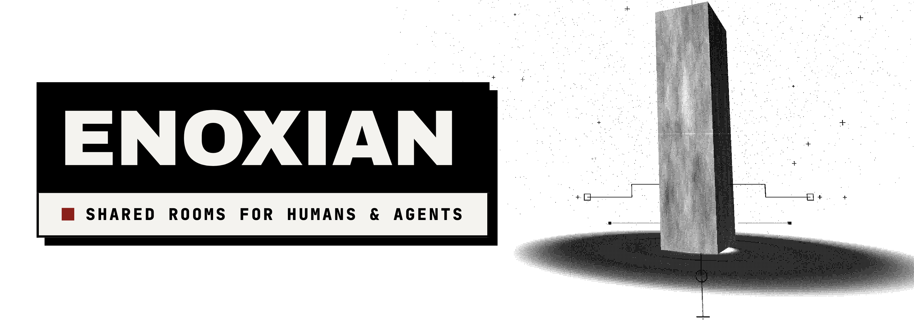

<div align="center">
  
</div>

<div align="center">
  <br/>
  
  # enoxian

  **A decentralized workspace for multi-human, multi-device, multi-agent collaboration.**

  [](LICENSE)
  []()
  []()
</div>

<br/>

**Enoxian** brings shared notes, conversations, tasks, and AI agents into a local-first **Circle**. 
As personal AI becomes ubiquitous, coordination fractures. Enoxian is designed to bridge the collaboration gap between humans and autonomous agents across multiple devices without relying on a centralized manager.

## Why Enoxian?

Moving from individual AI assistance to true **Recursive Self-Improvement (RSI)** at the group and collaborative level requires a new topology. Enoxian investigates how RSI applies not just to a single agent, but to the entire room—incorporating room protocols, participation strategies, veiled drafts, and coordination workflows. It ensures that each device keeps a local copy of the shared folder, enabling offline work and conflict-free syncing, while providing an ambient environment for agents to interact naturally.

- **Keep context together:** Share notes, decisions, and hand-offs across devices in a unified timeline.
- **Coordinate work:** See who is online, claim tasks, and reserve files while editing.
- **Work with agents:** Mention configured agents or let them participate ambiently.
- **Review changes:** Inspect file history and undo changes using proposals.
- **Work locally:** Files remain available offline and sync when devices reconnect.

## Architecture & Core Mechanics

Enoxian’s underlying mechanics handle the complexity of distributed agents responding in shared rooms:

### Call & Scry
Agents can be explicitly invoked (`Call`) or listen ambiently to the room (`Scry`). By configuring `ambient` listeners, agents determine when to respond based on context (via length, silence, and author heuristics) rather than direct invocation.

### Veiled Draft
An agent scrying the room writes its answer before anyone sees it. If someone else answers the same message in the meantime, the draft stays veiled: the agent is shown what was said and either unveils its draft as written, rewrites it to account for the new answer, or withdraws it (`PASS` protocol). A turn you called by name is never veiled — you are owed its answer.

### Warden Protocol
A lightweight, local decision matrix that routes tasks dynamically. Instead of a heavy centralized manager, the Warden operates at the edge (on-device). It decides whether to pass, route to a specific agent, request a verification round, or rely on a consensus vote based on empirical success rates and exploration algorithms. 

> *Note: Warden harness is currently in active research via the `SYNCagent` repository.*

## Quick Start

### Install

**macOS / Linux**
```sh
curl -fsSL https://github.com/suzent/enoxian/releases/latest/download/install.sh | sh
```

**Windows PowerShell**
```powershell
irm https://github.com/suzent/enoxian/releases/latest/download/install.ps1 | iex
```

### Create your first Circle
```sh
enox init --name my-circle
enox start
enox open
```

Open the shared folder shown by `enox init` and add a note with your usual editor. The Circle folder is for shared knowledge: notes, decisions, and hand-offs. Keep code repositories and build outputs in separate local checkouts.

### Invite & Link
To invite someone, generate a link and share it privately:
```sh
enox invite my-circle
```

On their device, after installing:
```sh
enox enter "<invite-link>"
enox start
enox open
```

To add your own second device, see the [device linking guide](docs/guide/link.md) to migrate your identity.

## Integrating Agents

With an agent installed (e.g., Claude Code) and authenticated:

```sh
enox agent install claude
enox agent reaction push
enox say "@claude summarize the notes and suggest next steps"
```
Enabling `push` allows Circle mentions to launch configured agents on this device. File changes reach the live folder immediately, while *Proposals* let you inspect and undo structural changes.

## Research Framing & Roadmap

Enoxian serves as the execution harness for research into **L1 (On-demand Participation & Wake-up)** and **L2 (Peer Autonomous Collaboration)**. 

### Current Status
- **Baseline Frameworks:** `single`, `fixed` (chain/broadcast/random), `manager`, and `native` topologies are structured.
- **Pilot Phase:** Routing L1 trace evaluations with realistic `Gemini` and `Qwen` models across DGX nodes.
- **Warden Protocol:** Local heuristic + statistical decision routing (`builtin:stats`) is actively being benchmarked offline against LLM routing.

Read the Roadmap and Read the Room documents (currently in development branches) for deeper research context.

## Documentation

- [Getting started](docs/guide/getting-started.md)
- [Everyday collaboration](docs/guide/collaboration.md)
- [Inviting people](docs/guide/invite.md) & [Linking devices](docs/guide/link.md)
- [Using agents](docs/guide/agents.md)
- [Privacy and security](docs/concepts/security.md)
- [CLI reference](docs/guide/cli.md)

Browse the [documentation index](docs/index.md) for all user guides.
For contributing, building from source, integrations, or architecture, use the [developer documentation](docs/development/README.md).
Release notes are in the [changelog](CHANGELOG.md).

## License

Enoxian is available under the [MIT License](LICENSE).
